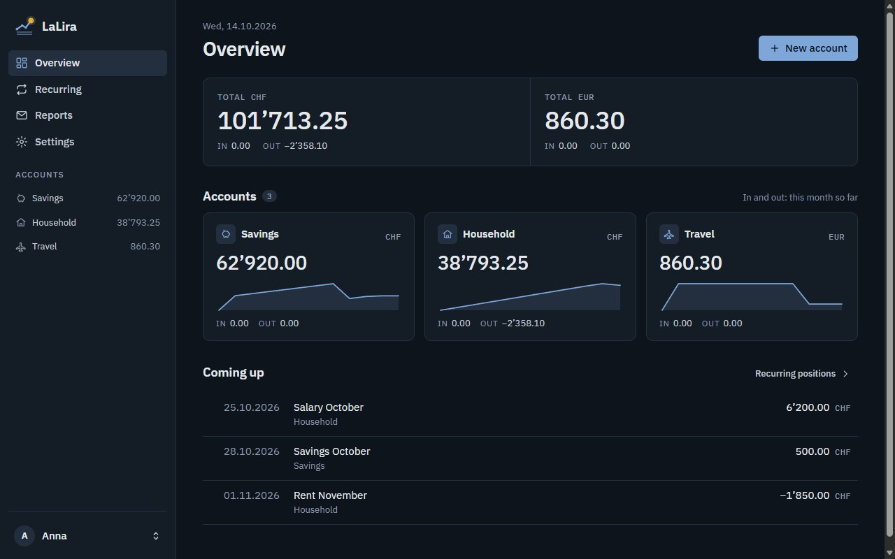
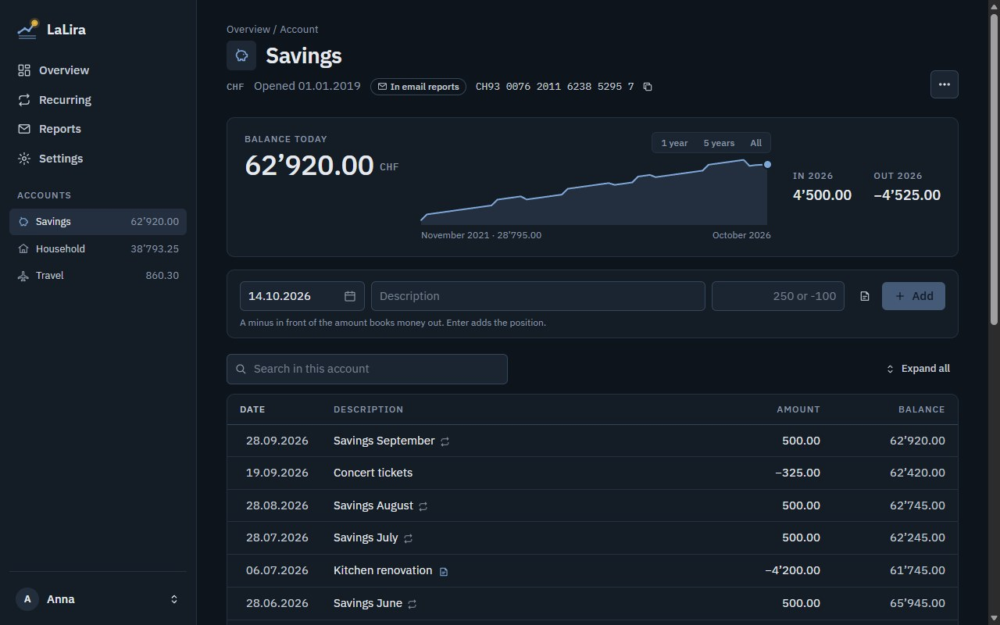

# LaLira

Simple, self-hosted bookkeeping for your accounts. Each account has a currency, a starting balance and a list of money in and out with a running balance; earlier years are summed up as their year-end balance. Recurring bookings book themselves, even after the app was down, and a report arrives by email when the month is over.





- **Accounts and positions**: a date, a description and an amount (a minus means money out), typed straight into the list, with an optional note. The current year shows every position; older years show one 31.12. line that opens on click, or all at once.
- **Balance chart and search**: the balance over 1 year, 5 years or everything, and a search through an account's descriptions, notes, amounts and dates.
- **IBAN**: optional per account, checked for typos, with a copy button.
- **Recurring positions**: weekly, monthly, quarterly or yearly, with placeholders such as `Deposit {month}` → "Deposit October". Missed dates are booked with their own date as soon as the app is back.
- **Email reports**: monthly, quarterly or yearly: money in and out and every booking, for the accounts you include.
- **CSV import and export**, with a preview and duplicate detection.
- **Backups**: a daily automatic backup, downloads with an optional password, and restore from the browser. Each backup also holds every account as a CSV file, and a safety backup is made before every update.
- **English and German**, with separate region formats (for example English with Swiss formats: 12’480.00, 14.10.2026).
- **Users**: the first user is the admin, who invites others; optional account requests from the sign-in page. Everyone's accounts are private.
- **Homepage widget**: your money in and out this month on a [gethomepage.dev](https://gethomepage.dev) dashboard.

## Run it with Docker

```yaml
services:
  lalira:
    image: ghcr.io/geeforceone/lalira:latest
    ports:
      - "8336:8080"
    volumes:
      - lalira-data:/data
    restart: unless-stopped

volumes:
  lalira-data:
```

Open http://localhost:8336 and create the admin user. Everything (database, keys, backups) lives in the `/data` volume. Keep `restart: unless-stopped`: a restore from the Backups page restarts the app.

To send invites, password resets and reports, enter your SMTP server under **Admin settings**.

## Develop

```
dotnet build LaLira.slnx
dotnet run --project src/LaLira.Web     # http://localhost:5336, data in ./data
dotnet test tests/LaLira.Tests
docker compose up --build
```

.NET 10, Blazor Server, SQLite. `src/LaLira.Core` holds all logic (no UI), so a future mobile app can reuse it; `src/LaLira.Web` is the web UI and host.

## License

MIT
